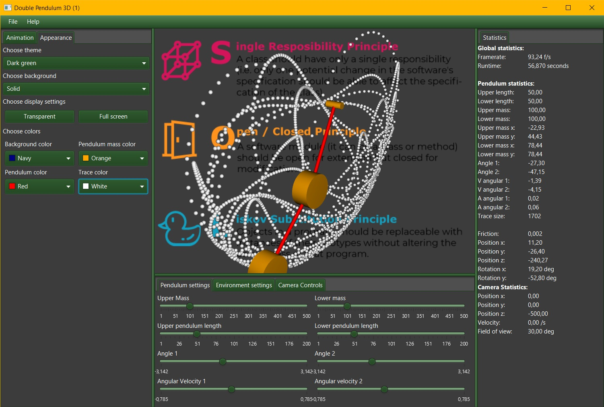

# Double Pendulum 3D

---

A 3D visualisation of a 3D pendulum

Made By Hans Zuidervaart.

---

## Screenshots

#### screenshot 1: A preview of the application

#### screenshot 2:

#### screenshot 3:

---

## Motivation

I was inspired by [this](https://www.youtube.com/watch?v=uWzPe_S-RVE) the coding train episode!

---

## Background

---

The motion of a double pendulum can be described by a system of ordinary differential equations (ODE's).

For background on how these equations can be derived and implemented in code, look at the following paper: [Thesis Kessels][Thesis_BTW_Kessels]

---

## Setup

The project is set up in such a way that it should feel like a plug and play experience

---

## Sources

- [openjfx-docs IDE Intellij](https://openjfx.io/openjfx-docs/#IDE-Intellij)

[Thesis_BTW_Kessels]:docs/Thesis_BTW_Kessels.pdf

---
