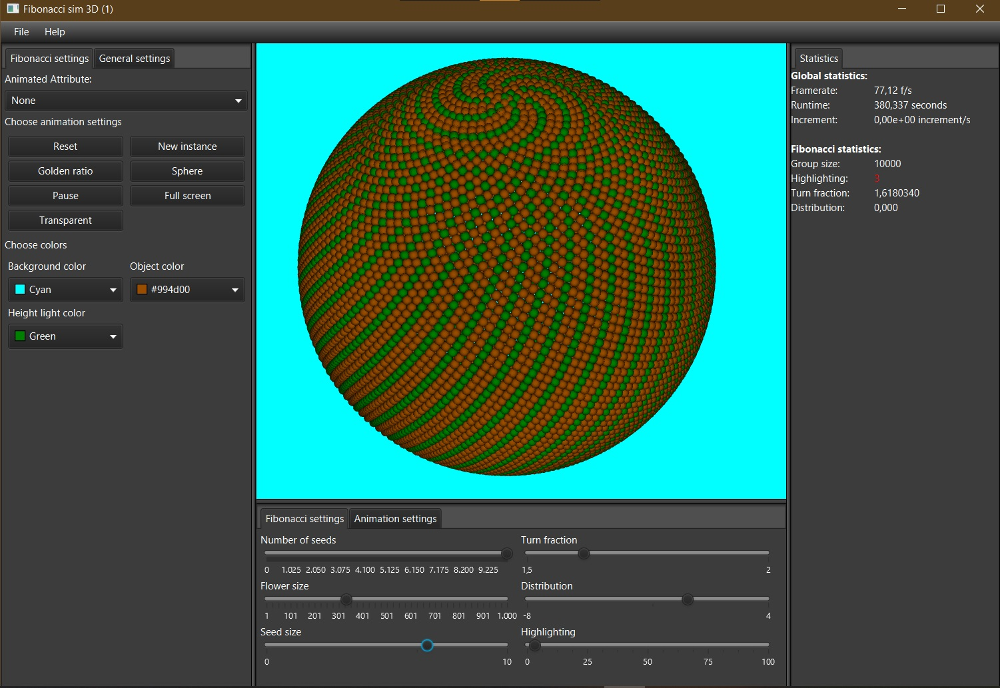
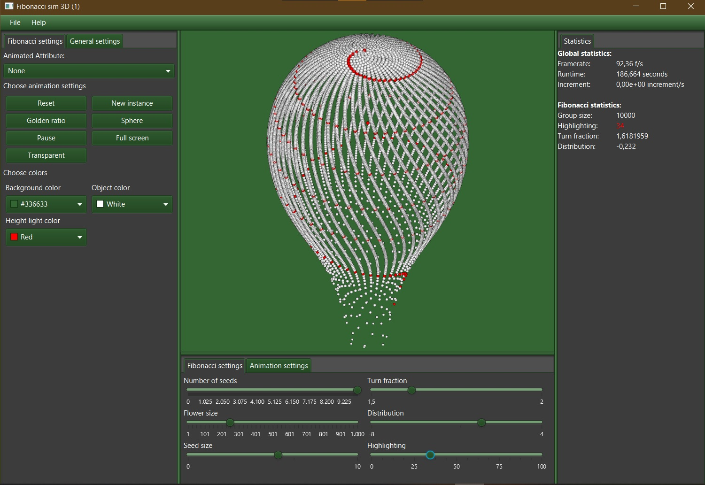

# Double Pendulum 3D

A 3D visualisation of a 3D pendulum

Made By Hans Zuidervaart.

## Screenshots

#### screenshot 1: A preview of the application

#### screenshot 2: 

#### screenshot 3: 

## Motivation
I was inspired by [this](https://youtu.be/bqtqltqcQhw?t=345) the coding train episode!

## Background

## Setup

## Sources
- [openjfx-docs IDE Intellij](https://openjfx.io/openjfx-docs/#IDE-Intellij)
